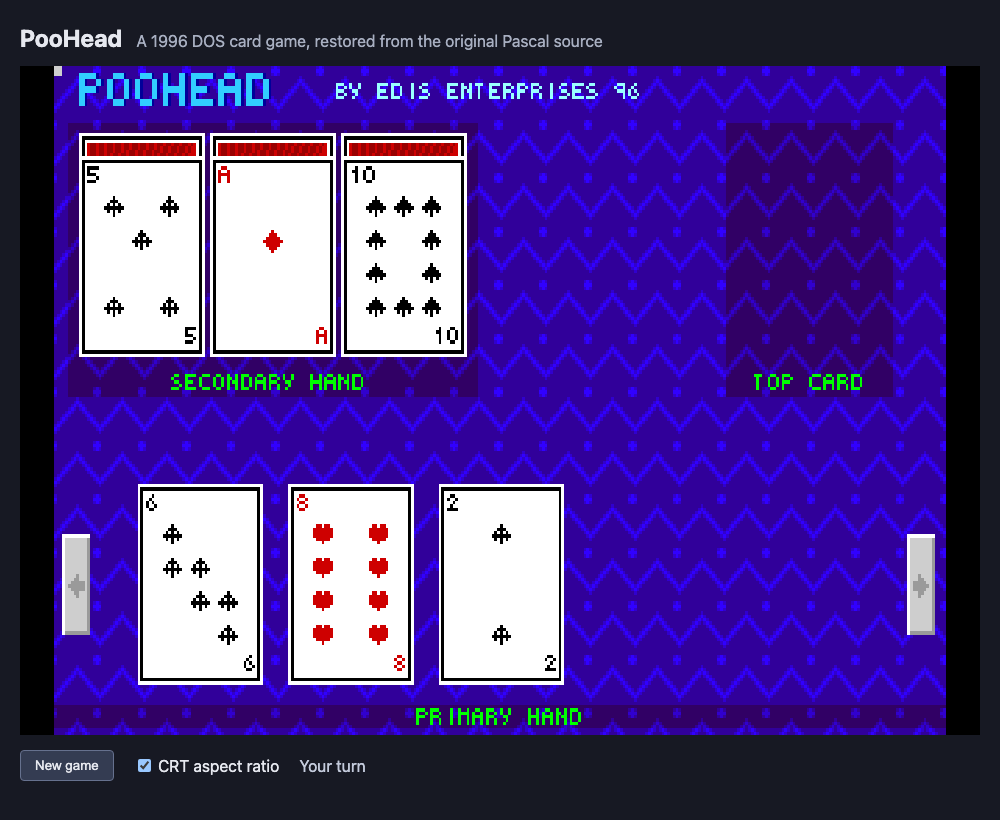

 

# PooHead

**[Play PooHead](https://deanthecoder.github.io/PooHead/)**

A browser revival of a DOS card game I wrote in **August 1996**, with updates
through **February 1997**. The original was called *ShitHead*, after the
traditional card game also known as Palace. This edition keeps the original
artwork and retro feel, under the friendlier **PooHead** page title.

## How to play

PooHead is a three-player shedding game: you play against two computer players.
Each player starts with three cards in hand, three face-up cards on the table,
and three face-down cards beneath them. Play from your hand first, then your
face-up cards, then the face-down cards without seeing them. The last player
still holding cards loses.

- Play a card equal to or higher than the top card of the pile, or pick up the
  pile. You and the CPUs can play several known cards of the same rank
  together. Face-down cards are revealed one at a time.
- A **2** can be played on anything, and anything can follow a 2.
- A **10** clears the pile and gives you another turn. Four of the same rank
  at the top of the pile does the same.
- While the draw deck has cards, your hand refills to three after a valid play.

Before the first turn, click face-up secondary cards to bring them into your
primary hand, then click primary cards to fill the empty face-up slots. Once
all three slots are filled, playing from your primary hand starts the game.

**Controls:** Tap or left click a card to play it. Hold a card for half a second
or right click cards of the same rank to select several, then tap or left click
one of them to play the selection. Tap or click the pile to pick it up. The
arrows beside your hand scroll it. The tiny square at the upper-left of the game screen shows card counts. Use **New game**
to redeal, or tap the final results to play again. **CRT aspect ratio** gives
the picture the proportions of an old monitor; turn it off for square pixels.

## Original game

The surviving game, artwork and source are preserved unchanged in
[`original/`](original/).

## License

MIT. See [LICENSE](LICENSE).
